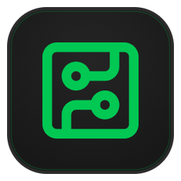
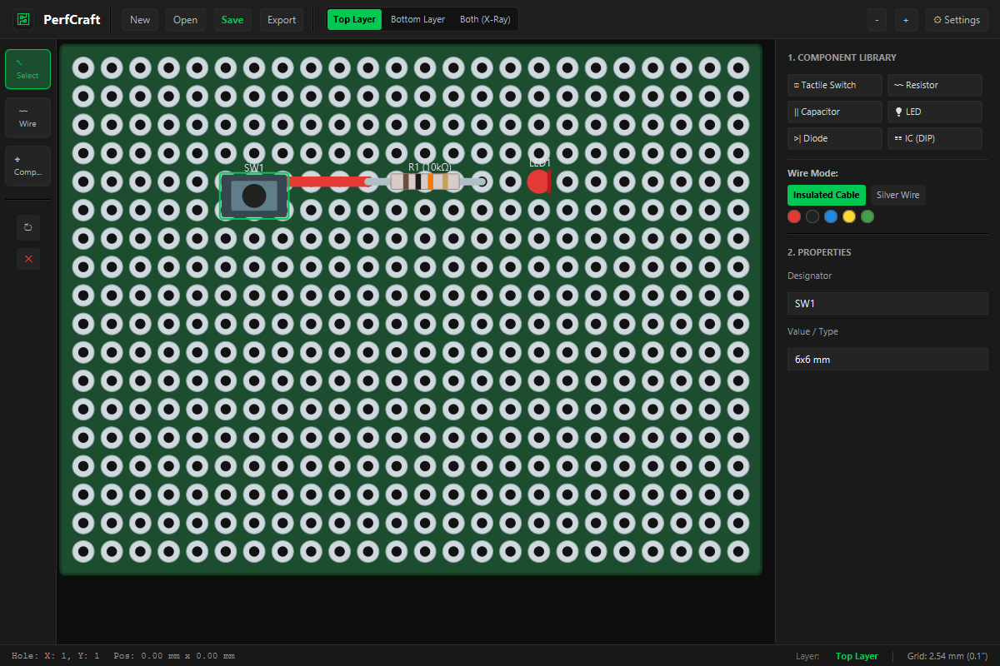

<div align="center">



```text
  ____            __  ____            __ _   
 |  _ \ ___ _ __ / _|/ ___|_ __ __ _ / _| |_ 
 | |_) / _ \ '__| |_| |   | '__/ _` | |_| __|
 |  __/  __/ |  |  _| |___| | | (_| |  _| |_ 
 |_|   \___|_|  |_|  \____|_|  \__,_|_|  \__|
                                              
```

**Intuitive, clutter-free Perfboard & Stripboard CAD Designer built with Java 21 LTS and JavaFX 21**

[](https://github.com/exitishere42/perfcraft/releases/latest)
[](LICENSE)
[](https://adoptium.net)
[](https://openjfx.io)

</div>

---

## Overview

**PerfCraft** is an intuitive, fast, and modern CAD tool for designing, prototyping, and verifying through-hole electronics circuits on perfboards and stripboards.

Inspired by LochMaster, Fritzing, and KiCad, PerfCraft avoids visual clutter and complex menus, providing a clean 2D vector canvas with high-visibility silver solder pads, automatic IEC resistor color codes, tactile switch footprints, real-time copper net highlighting, and one-click production exports.

<div align="center">
  
</div>

---

## How It Works & Core Workflow

PerfCraft revolves around an efficient 3-tool workflow accessible via instant hotkeys:

```text
+-------------------+      +-------------------------+      +--------------------------+
|  1. SELECT TOOL   |      |   2. WIRE / JUMPER      |      |   3. COMPONENT PLACER    |
|       [ V ]       |      |          [ W ]          |      |          [ C ]           |
|                   |      |                         |      |                          |
|  * Move & Rotate  | ===> |  * Tinned Silver Wire   | ===> |  * IEC Resistors (Bands) |
|  * Inspect Nodes  |      |  * Insulated Jumpers    |      |  * Tactile Switches      |
|  * Delete & Group |      |  * Real-Time BFS Net    |      |  * LEDs, Caps, Diodes, IC|
+-------------------+      +-------------------------+      +--------------------------+
```

1. **Select Tool (`V`)**:
   - Click any component or wire to select it.
   - Press `R` to rotate components in 90° increments.
   - Press `Delete` or `Backspace` to remove elements.
   - Real-time inspector in the right panel updates instantly.

2. **Wire / Jumper Tool (`W`)**:
   - Click on any start hole and drag or click to the destination hole.
   - Choose between **Insulated Jumpers** (colored wiring) or **Tinned Copper/Silver Wire** (bare bridging).
   - Click any pad or trace to trigger KiCad-style net continuity highlighting across all connected pins.

3. **Component Placer (`C`)**:
   - Select a component type from the left toolbar.
   - Move the cursor across the canvas with live ghost placement and pad snap.
   - Click to place.

---

## Component Library

- **Axial Resistors**: Automatically renders real IEC 60062 4-band or 5-band color rings on the canvas based on the entered ohmic value (e.g. `220`, `4.7k`, `10k`, `1M`).
- **Tactile Switches**: Standard 6x6 mm 4-pin momentary push buttons with correct pin-pair routing.
- **LEDs & Diodes**: Polarity indication with anode/cathode orientation markings and customizable lens colors.
- **Capacitors**: Disc ceramic packages and polarized electrolytic cans with negative stripe.
- **DIP Integrated Circuits**: Configurable pin counts (DIP-8, DIP-14, DIP-16, DIP-28, etc.) with pin 1 index notch.

---

## Design Rule Check (DRC) & Continuity Highlighting

- **Net Highlighting**: Click any pad or wire to trace all connected solder pads, jumper segments, and component pins using breadth-first graph traversal (BFS).
- **DRC Engine**: Automatically checks for:
  - Components or leads positioned off-board.
  - Pin collisions and overlapping component terminals.
  - Solder bridge short circuits.

---

## Keyboard Shortcuts

| Shortcut | Description |
| :--- | :--- |
| `V` | Select Tool |
| `W` | Wire / Jumper Tool |
| `C` | Component Placer Tool |
| `R` | Rotate selected component (0°, 90°, 180°, 270°) |
| `Delete` / `Backspace` | Delete selected element |
| `Ctrl + N` | Create a new board (custom grid width & height) |
| `Ctrl + O` | Open saved project (`.perf`) |
| `Ctrl + S` | Save current project (`.perf`) |
| `Ctrl + E` | Export high-resolution PNG image (1x, 2x, 4x) |
| `Ctrl + B` | Export Bill of Materials (BOM) as CSV |
| `Ctrl + +` / `Ctrl + -` | Zoom in / Zoom out (50% to 300%) |
| `Ctrl + 0` | Reset zoom to 100% |
| `Middle Click Drag` / `Right Drag` | Pan canvas |

---

## Installation & Setup

### Windows

Install with one PowerShell command:

```powershell
powershell -Command "Invoke-WebRequest -Uri 'https://raw.githubusercontent.com/exitishere42/perfcraft/main/install.bat' -OutFile 'install.bat'; .\install.bat"
```

Or download the executable `perfcraft.exe` (Windows) or `perfcraft-1.0.4-all.jar` directly from [Releases](https://github.com/exitishere42/perfcraft/releases/latest) and run:

```cmd
perfcraft.exe
```

or via Java 21+:

```cmd
javaw -jar perfcraft-1.0.4-all.jar
```

- Automatic `.perf` file type registration and custom document icon in Windows Explorer.
- Desktop and Start Menu shortcuts created automatically.

### Linux (Ubuntu, Debian, Fedora, Arch)

Install via the automated setup script:

```bash
curl -fsSL https://raw.githubusercontent.com/exitishere42/perfcraft/main/install.sh | bash
```

Or run directly with Java 21+:

```bash
java -jar perfcraft-1.0.4-all.jar
```

---

## PerfCraft Web & Docker Deployment

PerfCraft is also available as a zero-install, responsive web application for desktop browsers, tablets, and smartphones. It supports 1:1 `.perf` file opening/saving (including drag & drop) and touch gestures (pinch-to-zoom, 2-finger pan, Tinkercad-style component placement).

### Quick Start with Docker Compose

Run PerfCraft Web anywhere with a single command:

```bash
docker compose up -d
```

Once running, access the web interface in your browser:
- **Local machine**: [http://localhost:8080](http://localhost:8080)
- **Local Network (Tablets / Phones)**: `http://<your-server-ip>:8080`

To stop the container:

```bash
docker compose down
```

### Docker Compose Configuration (`docker-compose.yml`)

```yaml
services:
  perfcraft-web:
    build:
      context: .
      dockerfile: Dockerfile
    container_name: perfcraft-web
    restart: unless-stopped
    ports:
      - "8080:80"
    environment:
      - NODE_ENV=production
```

### Running Locally without Docker

```bash
cd web
npm install
npm run dev
```

Open [http://localhost:5173](http://localhost:5173).

---

## Building from Source

Requirements: OpenJDK 21 LTS and Apache Maven.

```bash
git clone https://github.com/exitishere42/perfcraft.git
cd perfcraft
mvn clean test
mvn package -DskipTests
```

Run directly:

```bash
java -jar target/perfcraft-1.0.4-all.jar
```

---

## License

This project is licensed under the MIT License - see the [LICENSE](LICENSE) file for details.
