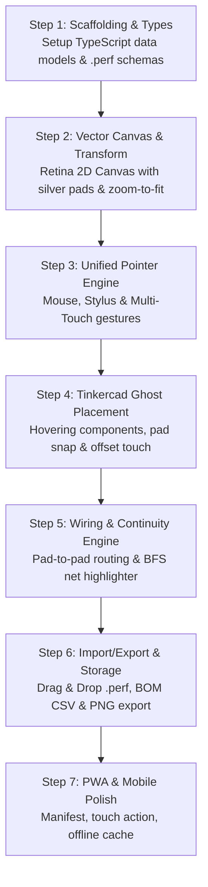

# Architecture & Implementation Specification: PerfCraft Web (Touch & Cloud Edition)

> **Document Status**: Production Blueprint / Instruction Specification  
> **Target Platform**: Modern Web Browsers (Desktop Chrome/Firefox/Safari/Edge & Mobile/Tablet Touch: iPad, Android Tablets, Smartphones)  
> **Compatibility**: 100% 1:1 bi-directional compatibility with PerfCraft Desktop `.perf` JSON schema  
> **Inspirations**: Tinkercad Circuits (touch interactions, ghost placement, drawer library), KiCad (net continuity highlighting, DRC), LochMaster (perfboard matrix)

---

## 1. Executive Summary & Vision

**PerfCraft Web** is a zero-install, browser-native CAD workbench for perfboard and stripboard circuit prototyping. It allows users to:
1. Open and inspect existing `.perf` project files created with the PerfCraft Desktop application via drag & drop, file picker, or URL hash.
2. Edit, route wires, place components, and modify values on both desktop (mouse/keyboard) and touch-first devices (tablets, iPads, phones with capacitive stylus or finger input).
3. Export back to `.perf` (JSON), CSV Bill of Materials (BOM), and high-resolution PNG canvas graphics.
4. Run 100% offline via modern Progressive Web App (PWA) capabilities and client-side web workers.

---

## 2. Core Architecture & Tech Stack

```text
+---------------------------------------------------------------------------------------+
|                                    PERFCRAFT WEB                                      |
+---------------------------------------------------------------------------------------+
|  [ Presentation Layer ]                                                               |
|  - HTML5 Canvas + High-DPI Retina Support (devicePixelRatio scaling)                  |
|  - Pointer Events API (Unified Mouse, Pen, Multi-Touch Pinch/Pan Engine)               |
|  - CSS Hardware Acceleration (will-change: transform)                                 |
+---------------------------------------------------------------------------------------+
|  [ Interaction & Tool Engine ]                                                        |
|  - 3-Tool System: Select (V), Wire / Jumper (W), Component Placer (C)                 |
|  - Tinkercad Ghost Placement Engine (Live hovering & Pad-Snapping)                   |
|  - Touch Gestures: 1-finger drag/wire, 2-finger pinch-to-zoom & pan, long-press context|
+---------------------------------------------------------------------------------------+
|  [ Domain Logic & Services ]                                                          |
|  - ContinuityService.ts (BFS Graph Traversal for real-time copper net highlighting)    |
|  - DrcService.ts (Off-board validation, terminal collision, short-circuit checks)    |
|  - ResistorColorCode.ts (IEC 60062 4-band / 5-band generator & parser)                |
|  - ProjectStorageService.ts (Schema validation, JSON serialization, File System API)   |
|  - ExportService.ts (PNG canvas renderer, CSV BOM generator)                         |
+---------------------------------------------------------------------------------------+
|  [ Data & Offline Engine ]                                                            |
|  - IndexedDB (Auto-save draft state & offline persistence)                            |
|  - Service Worker (Full offline PWA cache)                                            |
|  - File System Access API (Native Direct Save & Open where supported)                |
+---------------------------------------------------------------------------------------+
```

### 2.1 Technology Choices
- **UI & Graphics**: Vanilla TypeScript / ES2024 with HTML5 Canvas 2D Rendering Context (Direct vector rendering identical to JavaFX GraphicsContext for zero-overhead performance, 60-120 FPS).
- **Styling**: Sleek dark theme matching the desktop look (`#121212` canvas base, `#1E1E1E` panels, `#2C2C2C` dividers, `#00C853` cyber-mint accents, `#CFD8DC` silver solder pads).
- **Bundle & Build**: Lightweight Vite bundler (single HTML / self-contained bundle option for portable offline use).
- **No Heavy Framework Overhead**: Avoiding heavy frameworks ensures sub-100ms cold boot times and instant touch responsiveness on mobile processors.

---

## 3. Data Schema & Bi-Directional `.perf` Compatibility

The web edition adheres strictly to the existing PerfCraft JSON format:

```json
{
  "name": "Blink-Timer-Circuit",
  "board": {
    "columns": 24,
    "rows": 18,
    "pitchMm": 2.54,
    "padDiameterMm": 2.1,
    "drillDiameterMm": 1.0
  },
  "components": [
    {
      "id": "c1",
      "type": "RESISTOR_AXIAL",
      "designator": "R1",
      "value": "10k",
      "start": { "x": 4, "y": 6 },
      "end": { "x": 8, "y": 6 },
      "rotation": 0,
      "layer": "TOP"
    },
    {
      "id": "c2",
      "type": "TACTILE_SWITCH",
      "designator": "SW1",
      "value": "6x6 mm",
      "start": { "x": 10, "y": 6 },
      "end": { "x": 12, "y": 7 },
      "rotation": 0,
      "layer": "TOP"
    }
  ],
  "wires": [
    {
      "id": "w1",
      "kind": "CABLE",
      "layer": "TOP",
      "color": "#E53935",
      "points": [
        { "x": 8, "y": 6 },
        { "x": 10, "y": 6 }
      ]
    }
  ]
}
```

---

## 4. Tinkercad-Style Touch & Placement Engine

### 4.1 Unified Pointer Events Engine
Rather than splitting touch and mouse listeners, PerfCraft Web implements the modern **W3C Pointer Events API** (`pointerdown`, `pointermove`, `pointerup`, `pointercancel`) with Pointer Capture:

| Input Modality | Action | Web Handler |
| :--- | :--- | :--- |
| **Mouse Left Click** | Select, start wire, or place component | `pointerdown (button === 0)` |
| **Mouse Right / Middle Click** | Pan canvas | `pointermove` with delta |
| **Mouse Wheel** | Zoom at cursor pivot | `wheel` event with exponential smoothing |
| **1-Finger Touch Tap** | Select or place | `pointerdown` -> `pointerup` (< 250ms, < 5px delta) |
| **1-Finger Touch Drag (Wire Tool)** | Route wire pad-to-pad with live rubber-banding | `pointermove` with grid snapping |
| **1-Finger Touch Drag (Select Tool)** | Move selected component across grid holes | Live grid delta calculation |
| **2-Finger Pinch** | Continuous Zoom in / out centered at touch midpoint | Euclidean distance between pointer 1 & pointer 2 |
| **2-Finger Pan / Drag** | Pan canvas across the viewport | Midpoint delta tracking |
| **Long Press (500ms)** | Context menu (Rotate, Delete, Duplicate, Properties) | Timer on `pointerdown`, cancelled on move |

### 4.2 Tinkercad-Style Component Drawer & Ghost Preview
1. **Collapsible Bottom/Side Drawer**:
   - On desktop: Left vertical sidebar with instant hotkeys (`V`, `W`, `C`).
   - On tablets & smartphones: Swipeable bottom sheet or expandable drawer showing component cards with large touch-friendly targets (minimum 48x48 dp).
2. **Ghost Floating & Snap**:
   - Selecting a component from the drawer spawns a **semi-transparent Ghost** (60% alpha) attached to the cursor or touch point.
   - On touch devices, an offset of 30px above the finger is provided ("Touch Sight Offset") so the user's thumb does not obscure the target solder holes.
   - When hovering near a pad, the ghost snaps instantly to the 2.54 mm coordinate and draws glowing green target circles (`#00E676`) around the active terminal holes.
   - A single tap places the component and activates the floating action bar (Rotate, Value, Delete).

---

## 5. UI Layout & Responsive Breakpoints

```text
DESKTOP VIEW (>= 1024px):
+------------------------------------------------------------------------------------+
| [Logo] PerfCraft Web   [New] [Open] [Save] [Export]    [Top] [Bottom] [Both]   [⚙] |
+-----------+------------------------------------------------------------+-----------+
| TOOLS     |                                                            | INSPECTOR |
| [V] Select|                   CANVAS WORKBENCH                         | R1 (10k)  |
| [W] Wire  |                                                            | [Bands]   |
| [C] Comp  |               [ Full-View Perfboard ]                      | Nodes: 4  |
|           |                                                            | DRC: OK   |
+-----------+------------------------------------------------------------+-----------+
| Status: X: 14, Y: 12 | 35.56 mm x 30.48 mm | Grid: 2.54mm | Zoom: 100%             |
+------------------------------------------------------------------------------------+

TABLET & MOBILE VIEW (< 1024px):
+------------------------------------------------------------------------------------+
| [Logo] PerfCraft Web       [ 📁 ] [ 💾 ] [ ⤓ ] [ ↺ ] [ ↻ ]                     [ ⚙ ]|
+------------------------------------------------------------------------------------+
|                                                                                    |
|                           FULL-SCREEN TOUCH CANVAS                                 |
|                         (Pinch-Zoom / 2-Finger Pan)                                |
|                                                                                    |
|   +----------------------------------------------------------------------------+   |
|   | Floating Quick Controls: [ 👆 Select ] [ ⚡ Wire ] [ ＋ Comp ] [ 🔄 Rotate ] |   |
|   +----------------------------------------------------------------------------+   |
+------------------------------------------------------------------------------------+
| BOTTOM SHEET / DRAWER: Resistor | Switch | LED | Cap | Diode | DIP-8 | DIP-16      |
+------------------------------------------------------------------------------------+
```

---

## 6. Key Modules & Services Specification

### 6.1 `CoordinateTransform.ts`
- Encapsulates scale, pan offsets, and DPR (Device Pixel Ratio) compensation.
- `gridToScreen(gx, gy)` and `screenToGrid(sx, sy)`.
- `zoomToFit(canvasWidth, canvasHeight, cols, rows)`: Automatically calculates optimal scale on load so the perfboard fills the mobile/desktop viewport edge-to-edge.

### 6.2 `PerfBoardCanvas.ts`
- Manages the primary HTML5 `<canvas>` element and offscreen staging buffer.
- Vector rendering routines:
  - Substrate background with rounded corners.
  - Solder pads: Pure silver rings (`#CFD8DC`) with outer bevel (`#90A4AE`) and dark drill holes (`#121212`).
  - Real IEC 60062 resistor color code bands.
  - 6x6 mm tactile switches with 4 metal solder lugs and tactile button actuator.
  - LED lenses with flat cathode notch and polarity markers.
  - Integrated circuits with pin-1 notch.
  - Wire routing (insulated colored cables & bare tinned copper/silver jumper tracks).

### 6.3 `ContinuityService.ts`
- Builds an adjacency list from connected pins and copper jumper traces.
- BFS graph traversal triggers when tapping any pad or wire with net highlighting enabled.
- Highlights all connected nodes in high-visibility amber/neon yellow (`#FFEE58`).

### 6.4 `ProjectStorageService.ts`
- Uses the HTML5 `FileReader` and `Blob` APIs for universal desktop and mobile `.perf` file import/export.
- Integrates with the modern `window.showOpenFilePicker` and `window.showSaveFilePicker` (Chromium/Edge/Android) with fallback to `<input type="file">` and programmatic `<a download>`.

---

## 7. Step-by-Step Implementation Roadmap



---

## 8. Definition of Done (DoD)

1. **File Compatibility**: Every `.perf` file saved by PerfCraft Desktop loads without errors in PerfCraft Web, and every file saved in PerfCraft Web opens identically in the desktop application.
2. **Touch First-Class Citizen**: Complete circuit design (board creation, component placement, wire routing, rotation, deletion) is 100% operable on touch screens without requiring a physical keyboard or mouse.
3. **Performance**: Smooth 60 FPS panning, zooming, and ghost dragging on both desktop and mid-range mobile devices.
4. **Offline Ready**: Fully functional offline without an active internet connection.
